# BIOME: Baseline-Individualized Onboard Microbiome Evaluation

**BIOME is an offline-capable, personalized health-monitoring application designed to track vaginal microbiome changes in female astronauts during long-duration spaceflight.** It combines individual health baselines, routine health assessments, quantitative molecular measurements and longitudinal analysis to identify potentially concerning changes and support onboard medical decision-making.

| | |
| --- | --- |
| Competition | NASA Space Apps Challenge 2026 |
| Challenge | *Create Health Monitoring Software for Astronauts on Space Missions* [6] |
| Team | Team Pigeon (three members): Chatchaya Chaimchareon, Phawinee Auewattanamongkol, Olan Sinsuriya |
| Live website | https://olanbonk.github.io/biome/ |
| Software version | `0.9.0-hackathon` (the `VERSION` constant in `index.html`) |

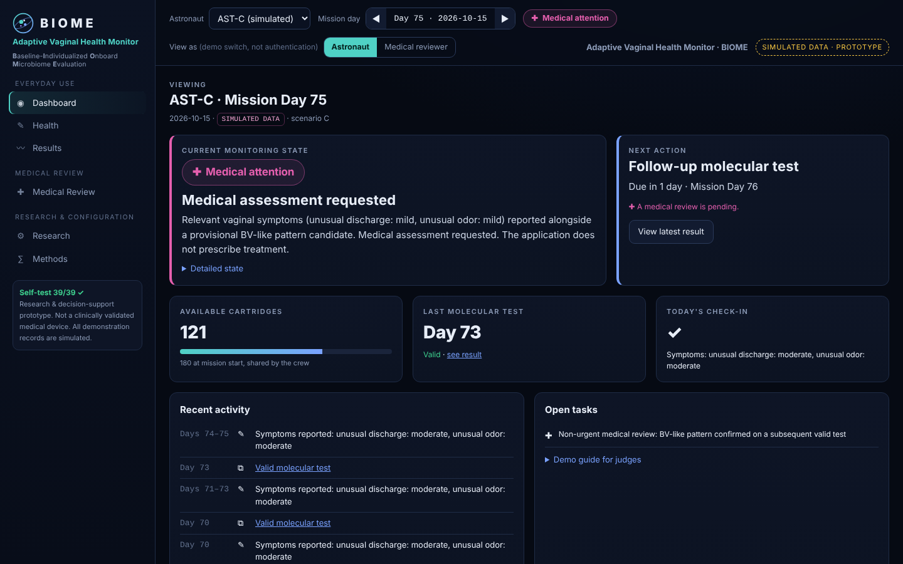

### Principal capabilities

- **Individual baselines.** Each astronaut is compared with her own pre-flight reference profile, which a medical reviewer must approve.
- **Molecular quality control and calibration.** qPCR run controls are checked before anything is interpreted. Cq/Ct values are converted to abundance with assay- and lot-specific standard curves.
- **Longitudinal statistics.** Each test gives individual prediction limits, fold changes, Student's t p-values and a Holm multiple-target correction.
- **Microbial pattern interpretation.** BV-like patterns, neutral *Lactobacillus* enrichment, *L. iners* and *Candida* are handled separately.
- **An explainable decision engine.** Eleven numbered rules (R0–R10) set the monitoring state, the recommended action and the next test date. Every recommendation names its rule.
- **Adaptive testing and cartridge accounting.** Testing frequency responds to the monitoring state. Invalid tests still count against the cartridge inventory.
- **Medical-reviewer tools.** A reviewer can approve or reject baselines, record clinical decisions and produce a structured hand-off report.
- **Six simulated demonstration astronauts (A–F).** They run through exactly the same engine as manually entered data.
- **A benchmark.** It compares adaptive testing with fixed 3-, 7- and 14-day schedules over 100 simulated missions per configuration.
- **A research archive.** CSV/JSON export, a data dictionary and a de-identification preview, organized with NASA's Open Science Data Repository (OSDR) in mind.
- **Built-in self-tests.** 39 automated checks run every time the page loads.

### Project status

| Component | Status |
| --- | --- |
| Browser-based monitoring software (`index.html`) | **Implemented.** Every feature described in Section 4 works in the current file. |
| Demonstration astronauts, measurements and calibration values | **Simulated.** No record in BIOME is a real astronaut measurement or NASA data. |
| Swab-to-qPCR physical testing workflow and molecular panel | **Proposed.** It has not been built, validated or flight-qualified. |
| Clinical validity and operational suitability | **Not established.** BIOME is a monitoring and decision-support prototype, not a diagnostic device and not a substitute for clinical assessment. |

---

## Contents

1. [Project overview](#biome--baseline-individualized-onboard-microbiome-evaluation)
2. [The problem: female health in long-duration spaceflight](#2-the-problem-female-health-in-long-duration-spaceflight)
3. [The proposed solution](#3-the-proposed-solution-what-biome-develops)
4. [How the website works: complete user guide](#4-how-the-website-works-complete-user-guide)
5. [How the personalized analysis engine works](#5-how-the-personalized-analysis-engine-works)
6. [Demonstration scenarios A–F](#6-demonstration-scenarios-af)
7. [Simulation and benchmarking](#7-simulation-and-benchmarking)
8. [Technical architecture and implementation](#8-technical-architecture-and-implementation)
9. [Scientific basis and NASA research context](#9-scientific-basis-and-nasa-research-context)
10. [Validation and testing](#10-validation-and-testing)
11. [Privacy, data management and research contribution](#11-privacy-data-management-and-research-contribution)
12. [Limitations and known issues](#12-limitations-and-known-issues)
13. [Roadmap and future development](#13-roadmap-and-future-development)
14. [Installation and usage](#14-installation-and-usage)
15. [Team Pigeon and project goals](#15-team-pigeon-and-project-goals)
16. [AI use, acknowledgements and references](#16-ai-use-acknowledgements-and-references)

Labels used throughout: **Implemented** (works in the website), **Simulated** (generated for demonstration), **Proposed** (physical or operational systems that are not built or validated) and **Future development** (planned, not implemented).

---

## 2. The problem: female health in long-duration spaceflight

### 2.1 The female-specific research gap

Women have always been a minority of the people who have flown in space. More than 500 people have flown, and only about 11% of them were women [19]. NASA's first astronaut class to include women was selected in 1978 [19], almost two decades after the first astronaut selection. Many questions about the female body in spaceflight could not be studied with large or long-term datasets, because so few women had flown.

That is changing in new selections. NASA's 2025 astronaut candidate class has six women and four men. It is the agency's first class with more women than men [20]. These two figures describe different populations: one counts everyone who has ever flown, the other a single modern selection class. They should not be compared directly as rates. Together they show that as more women fly, female-specific health questions affect a larger share of crews.

The scientific literature reflects this gap. A 2024 systematic review found 16 studies on human reproductive health in spaceflight or relevant analogues, and only five included female participants [1]. A 2025 commentary on female astronaut health also identified open questions about reproductive and gynecological health during long-duration missions [2].

### 2.2 The vaginal microbiome and spaceflight

NASA's Human Research Program treats **host–microorganism interactions** as a spaceflight health risk. NASA notes that microorganisms and microbial communities can change during spaceflight. The health implications remain incompletely understood, as do the relative contributions of microbial change, microbial virulence and immune-system change [3]. Genitourinary conditions are also part of NASA's medical-risk picture. A probabilistic risk assessment of sex-dependent medical outcomes during spaceflight modeled urinary tract infection among its conditions [15].

How spaceflight affects the female reproductive microbiome is still largely unknown. The most direct evidence so far is a 2026 parabolic-flight study of four reproductive-age women [4]. It found substantially more taxonomic changes in vaginal samples than in oral samples after flight. These included increases in *Lactobacillus crispatus* and *L. jensenii*. The study had important limits:

- Only **four** participants took part.
- It studied **parabolic flight** (seconds of altered gravity at a time), not long-duration orbital missions.
- It cannot show whether the changes **persist**, whether they are **clinically significant** or whether they **cause infection**.

Its value for BIOME is narrower. It supports treating the vaginal microbiome as a biological system that may respond to altered gravity and is worth monitoring. It does not justify treating every microbial change as harmful.

**Why longitudinal monitoring?** An Earth-based study followed 32 women with twice-weekly vaginal sampling for 16 weeks [5]. Vaginal communities differed greatly in how stable they were over time. Their dynamics were associated with menstrual-cycle timing and community composition. Change in composition was not necessarily the same as dysbiosis. So one measurement cannot describe a person's "normal". A result is only meaningful compared with that person's own history and context. BIOME is built on this idea.

### 2.3 The operational problem

Deep-space missions change how medical care works. NASA describes **distance from Earth** as one of the five hazards of human spaceflight [18]. The practical consequences are:

- **Delayed communication** with specialists on Earth, so onboard crews must interpret more information themselves.
- **Limited medical supplies** and few or no resupply opportunities, so every test consumable matters.
- **Restricted evacuation options**, so recognizing concerning changes early and assessing them appropriately on board matters more than on the International Space Station.

BIOME addresses one narrow part of this problem. It helps a crew notice a meaningful change in one female-specific health domain, avoid overreacting to one-off results, use test cartridges carefully, and give an onboard medical reviewer structured, explainable information.

> **Scope distinction.** BIOME monitors vaginal microbiome changes. It does **not** diagnose urinary tract infections. It does not tell urinary infections apart from vaginal conditions, and it does not calculate UTI or evacuation risk. The current app records an optional urinary symptom item and two urinary red flags, for **referral only**. A urinary symptom creates a task that suggests a urine test, and a urinary red flag triggers the urgent pathway. Neither one changes the microbial analysis.

---

## 3. The proposed solution: what BIOME develops

BIOME is designed as three connected components. Only the second is implemented in this repository.

### 3.1 Physical testing concept (Proposed)

The proposed sample-to-measurement workflow is:

1. The astronaut collects a vaginal sample with a **sterile, single-use swab** and seals it in a sample tube.
2. An extraction and reaction kit releases **microbial DNA**.
3. The prepared sample goes into a disposable **qPCR cartridge** with target-specific primers and fluorescent probes. A compact real-time PCR analyzer amplifies the targets.
4. The instrument reports **Cq/Ct values**. These are converted to **calibrated abundance** with the assay's standard curve.
5. The measurements are **transferred to the onboard software**. A separate **pH strip or sensor** gives a supplementary reading.

**Proposed molecular panel**

| Target | Domain in BIOME | Why it is monitored |
| --- | --- | --- |
| *Lactobacillus crispatus* | Protective-associated *Lactobacillus* | Commonly associated with vaginal stability |
| *Lactobacillus jensenii* | Protective-associated *Lactobacillus* | Associated with vaginal health |
| *Lactobacillus gasseri* | Protective-associated *Lactobacillus* | Associated with vaginal health |
| *Lactobacillus iners* | Tracked separately | Found in both healthy and BV-associated communities, so never classed as protective or harmful |
| *Gardnerella vaginalis* | BV-associated | BV-associated organism |
| *Fannyhessea vaginae* (formerly *Atopobium vaginae*) | BV-associated | BV-associated organism |
| *Megasphaera* species | BV-associated | BV-associated bacteria; phylotypes should be distinguished if the assay supports it |
| BVAB2 (optional) | BV-associated | Additional marker, if supported by the selected assay |
| *Candida* species | Separate fungal pathway | Fungal populations relevant to yeast infection; may need a separate fungal assay |
| Total bacterial 16S | Total load | Overall bacterial quantity |
| Human sample control | Run QC | Shows the sample contains human cellular material (sample adequacy) |
| Internal amplification control | Run QC | Detects PCR inhibition or amplification failure |

The panel, its quantitative performance and the hardware are **proposed**. All of them need independent, assay-specific validation. The calibration values used in the app are **hypothetical simulation values** (Section 5.3).

### 3.2 Monitoring software (Implemented)

The website is the implemented part of BIOME. It:

- Establishes an **individual baseline** from pre-flight samples and requires reviewer approval.
- Collects **daily health assessments**: symptoms, optional pH, cycle phase and medication changes.
- Accepts **pH and molecular measurements** by manual entry, CSV import or a simulated instrument.
- Evaluates **measurement quality** before any interpretation.
- **Compares** each valid result with the astronaut's own baseline.
- **Tracks change over time** and requires a repeat test before treating a change as confirmed.
- Assigns a **monitoring state** using explicit rules.
- **Explains** every result with deterministic text that names the rules involved.
- **Recommends** the next monitoring action and test date.

### 3.3 Research archive (Implemented, for possible future use)

BIOME keeps every record in a structured, longitudinal form and can export it for research:

- **Coded identifiers.** Astronauts get codes such as `AST-C`, and samples get pseudonymous IDs. Names are never stored.
- **Mission-day information**, with calendar dates included only if the exporter enables them.
- **Assay and instrument metadata:** assay ID, calibration lot, cartridge ID and the standard-curve slope and intercept actually used.
- **Quantitative measurements and QC:** Cq, log10 abundance, detection/quantification limits, per-target QC status and run QC outcome.
- **Relevant health context:** pH, plus optional cycle-phase and medication fields, subject to consent and research protocols.
- **CSV and JSON exports**, a **data dictionary** and **provenance** information.

The JSON export is organized into study-, sample- and assay-level sections to ease **possible** future preparation for NASA's Open Science Data Repository [7, 8]. BIOME does **not** submit anything to NASA, and acceptance would never be automatic or guaranteed.

---

## 4. How the website works: complete user guide

This section is written so that you can operate BIOME with only this README. Button and field names are shown exactly as they appear in the app.

### 4.1 Interface overview

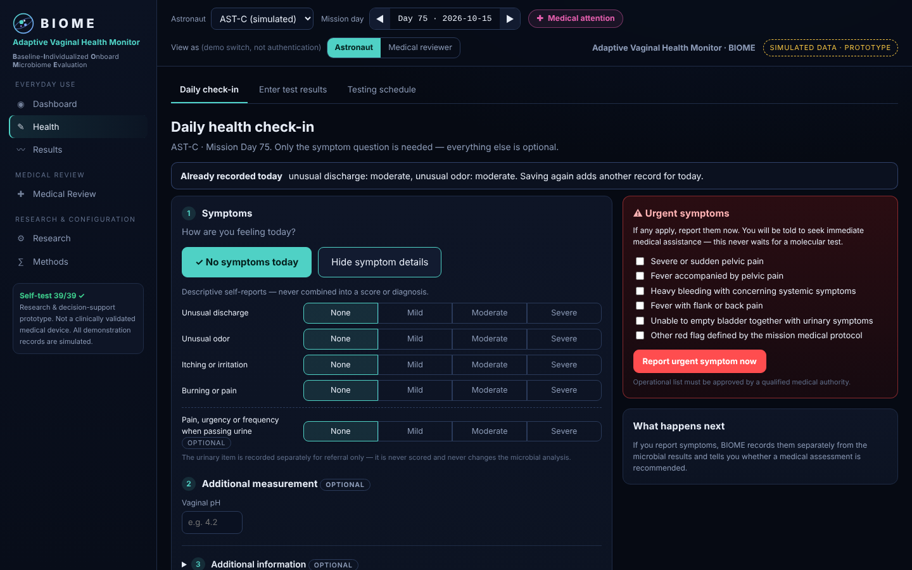

| Interface element | Where | Purpose |
| --- | --- | --- |
| **Astronaut** selector | Top bar | Chooses the astronaut whose records you are viewing |
| **Mission day** control (◀ / ▶) | Top bar | Shows the current mission day and its calendar date. ▶ advances one day; ◀ goes back one day (see the known issue in 4.7) |
| **Status badge** | Top bar | The selected astronaut's plain-language status |
| **View as** (Astronaut / Medical reviewer) | Top bar | Switches between the two views. Labelled *demo switch, not authentication* |
| **Simulated data · prototype** label | Top bar | Reminds you that demonstration records are simulated |
| **Urgent banner** | Under the top bar | Appears whenever the selected astronaut has an unresolved red-flag symptom |
| **Left navigation** | Left side | Dashboard, Health, Results (*Everyday use*), Medical Review (*Medical review*), Research and Methods (*Research & configuration*) |
| **Self-test indicator** | Bottom of the left navigation | Shows the automated self-test result (e.g. *Self-test 39/39 ✓*). Click it to open Methods → Self-tests |

Health, Results, Medical Review, Research and Methods each have **sub-tabs** under the page title. On narrow screens the left navigation becomes a horizontal bar at the top.

**Two levels of status terminology**

| Plain-language label (shown everywhere) | Internal state(s) (shown in detailed views) |
| --- | --- |
| ● **Routine** | Baseline, Stable |
| ▲ **Additional monitoring** | Watch, Monitor |
| ✚ **Medical attention** | Clinical Review |
| ⚠ **Urgent** | Urgent overlay: a separate flag that overrides everything else |

The internal state appears under *Detailed state* on the Dashboard, in each result's *Advanced analysis* and in the reviewer views. Status is never shown by color alone: every badge also has a symbol and text.

### 4.2 Initial application state

When you open BIOME for the first time in a browser:

- **AST-A** is selected and **Mission Day 75** (2026-10-15) is shown. The simulated mission starts on 2026-08-01.
- **Six simulated astronaut profiles** (AST-A to AST-F) are preloaded. Each one has eight weekly pre-flight baseline samples (days −56 to −7) and a baseline approved on day −1 by "Simulated reviewer (preset)". Each also has daily check-ins and the in-flight tests that the decision engine scheduled up to day 75.
- The crew shares one inventory of **180 cartridges**. The six presets have used 59, so **121** remain.
- The self-test indicator reports **39/39** passing.

| Astronaut | Demonstration scenario | Status at Day 75 (internal state) |
| --- | --- | --- |
| AST-A | Stable microbiome, with one invalid test (day 56) | Routine (Stable) |
| AST-B | Temporary *L. crispatus* increase that resolves | Routine (Stable): briefly Watch on days 42–44 |
| AST-C | Persistent BV-associated microbial changes followed by symptoms | Medical attention (Clinical Review) since day 66 |
| AST-D | Symptoms despite stable microbial measurements | Medical attention (Clinical Review) since day 32 |
| AST-E | *Candida* increase without symptoms | Routine (Stable); latest pattern "Candida increase alone" |
| AST-F | *Lactobacillus* enrichment without BV-associated increases | Additional monitoring (Monitor) since day 44, pattern classified as neutral enrichment |

These are **predefined simulated scenarios**, not real astronaut records. Section 6 describes each one.

Records are saved in your browser (Section 8.3). If you come back later, BIOME reopens with whatever you left, including the mission day and any records you added. **Research → Research archive → Backup & records → Reset to demonstration presets…** restores the starting state above.

### 4.3 Astronaut daily check-in

Open **Health → Daily check-in**. The form has three numbered parts, and only the first is needed.

1. **Select the astronaut** in the top bar.
2. **Symptoms.** Either:
   - Click **✓ No symptoms today**. This saves the check-in immediately. Anything already typed in parts 2 and 3 is saved with it.
   - Or click **Report symptoms…** to open the questionnaire. Rate each symptom as **None / Mild / Moderate / Severe**: *Unusual discharge*, *Unusual odor*, *Itching or irritation* and *Burning or pain*. You can also rate *Pain, urgency or frequency when passing urine*, which is optional and recorded separately for referral only.
3. **Additional measurement (optional).** Enter **Vaginal pH**.
4. **Additional information (optional).** Expand this to set the **Cycle phase**, describe **Medication or health changes** or add private **Notes**. Notes are never exported. If something major has changed (hormonal regimen, pregnancy, a new antibiotic course or a significant medical event), tick the box asking a reviewer to check the baseline. This creates an R10 baseline-review flag.
5. Click **Save check-in**.

The check-in is stored immediately and the decision engine re-evaluates the whole record. BIOME then returns to the Dashboard and briefly shows a message with the resulting status. While you fill in symptoms, the **What happens next** card shows assessment prompts, for example:

- Discharge or odor: *"This symptom pattern can occur with BV."*
- Itching or irritation: *"This symptom pattern can occur with yeast infection."*
- Burning or pain: *"This symptom pattern can occur with yeast infection or a urinary tract infection. A urine test may be needed."*
- Urinary item: a reminder that a urine test may be needed and that the panel does not assess UTI.
- Any symptom: *"Urinary or other causes cannot be excluded by this panel."*

These are prompts for assessment, not diagnoses. Symptoms are never added into a score.

**Urgent-symptom workflow.** The red **⚠ Urgent symptoms** card is always visible on the right and works independently of the normal check-in.

1. Tick each red flag that applies:
   - Severe or sudden pelvic pain.
   - Fever accompanied by pelvic pain.
   - Heavy bleeding with concerning systemic symptoms.
   - Fever with flank or back pain.
   - Unable to empty bladder together with urinary symptoms.
   - Other red flag defined by the mission medical protocol.
2. Click **Report urgent symptom now**.
3. The **urgent banner** appears at once, telling the crew to seek immediate medical assistance under the mission protocol. BIOME does not wait for a molecular test (rule R8).
4. The flag is **not** cleared by a later test or check-in. Only a medical reviewer can clear it, by recording a decision with *Urgent situation assessed: clear the Urgent alert* ticked (Section 4.8).

The red-flag list is a prototype. An operational list would need approval by a qualified medical authority.

### 4.4 Entering molecular test results

Open **Health → Enter test results**. Entry happens in three steps. Manual, CSV and simulated results all pass through the same quality-control, calibration, analysis and decision engines.

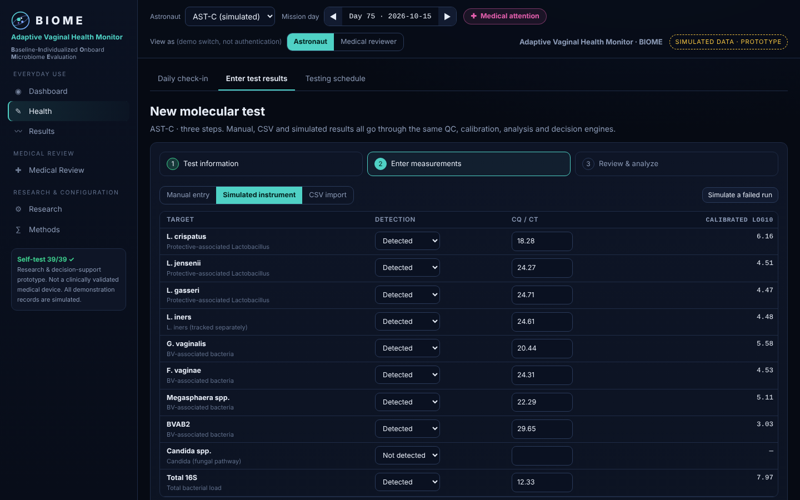

#### Step 1: Test information

| Field | Notes |
| --- | --- |
| **Mission day** | Defaults to the current day. **Negative days are pre-flight baseline samples**; they build the baseline and are not compared with a threshold. |
| **Test date** | Calendar date. It follows the mission day unless you edit it. |
| **Assay** | `BIOME-SIM-01` (default) or `BIOME-SIM-02`. Both are hypothetical simulated assays. SIM-02 represents a *different chemistry* with no validated conversion to SIM-01. |
| **Calibration-lot ID** | The lots belonging to the selected assay: `CAL-2026A` or `CAL-2026B` for SIM-01, `CAL-2027A` for SIM-02. |
| **Cartridge ID** | Free text, e.g. `CRT-0457`. |
| **Sample ID** | Generated automatically as a pseudonymous ID. |
| **Sample context** (optional, expandable) | Cycle phase at collection and hormonal/medication context. For pre-flight samples these appear in the baseline review. |
| **Sample-collection checklist** | Four steps, **unticked by default**: sterile single-use swab used; tube sealed and labelled with coded ID; extraction/reaction kit lot recorded; cartridge loaded in the analyzer. Whatever you tick is stored with the test. |

**Cartridge accounting.** Every in-flight test (mission day 0 or later) uses one cartridge, **even if it fails quality control**. Pre-flight baseline samples do not count against the flight inventory. Click **Next: enter measurements →**.

#### Step 2: Measurements

Choose an input method at the top of the step.

**1. Manual entry**

- For each target set **Detection**: *Detected*, *Not detected* or *Not run*.
- Type the **Cq / Ct** value. The **Calibrated log10** column updates live with the run's standard curve.
- Optionally, tick *Also enter the instrument's quantified abundance* to show a **Quantified log10** column. If you enter both a Cq and a quantified value, BIOME cross-checks them. A difference of more than **0.3 log10** marks that target as a QC failure ("inconsistent under the selected calibration").
- Enter the **Run controls** as reported by the instrument:
  - **No-template control:** *No amplification* or *Amplified*.
  - **Positive control:** *Pass*, *Fail* or *Not applicable*.
  - **Human sample control Cq:** leaving it blank means it did not amplify.
  - **Internal amplification control:** *Pass*, *Inhibition* or *Fail*.

**2. Simulated instrument**

- Click **Simulated instrument** to fill every field with values generated from the selected astronaut's scenario for that mission day. For manually created astronauts, the values come from a stable scenario. A simulated cartridge ID is filled in if the field is empty.
- Every value stays editable, and **anything you change takes precedence**. The test is labelled *simulated (editable)* in its record.
- **Simulate a failed run** loads a run whose human sample control fails. Use it to see how invalid tests are handled.

**3. CSV import**

- Click **CSV import** and choose a `.csv` file. Every valid row becomes a separate test record straight away, going through the same pipeline, and BIOME opens the last imported result.
- The first row must be a header. Recognized columns are listed below. `mission_day` is required; every other column is optional.

  ```text
  mission_day, test_date, assay, lot, cartridge_id, ntc, pc, hsc_cq, iac,
  <T>_status, <T>_cq, <T>_log10, <T>_m, <T>_b   (for each target code T), notes
  ```

  Target codes are `Lcr`, `Ljen`, `Lgas`, `Lin`, `Gva`, `Fva`, `Meg`, `BVAB2`, `Cand` and `T16S`. Status values are `detected`, `nd` or `missing`. Controls use `none`/`amplified` (NTC), `pass`/`fail`/`na` (PC) and `pass`/`inhibited`/`fail` (IAC). The parser splits on plain commas, so fields must not contain commas or quotes. There is currently no template-download button (see Section 12.2).

**Advanced: standard curve for this run, calibration & QC criteria** (expandable). This shows the slope *m* and intercept *b* for every target, pre-filled from the calibration lot. If the instrument reports run-specific standard-curve parameters, enter them here. They are stored with the test and used for conversion, and the line above the panel tells you which targets use run-specific values. The panel also lists each target's detection, quantification and upper limits and the human-sample-control acceptance criterion. Control acceptance criteria cannot be changed here.

Click **Next: review →**.

#### Step 3: Review and save

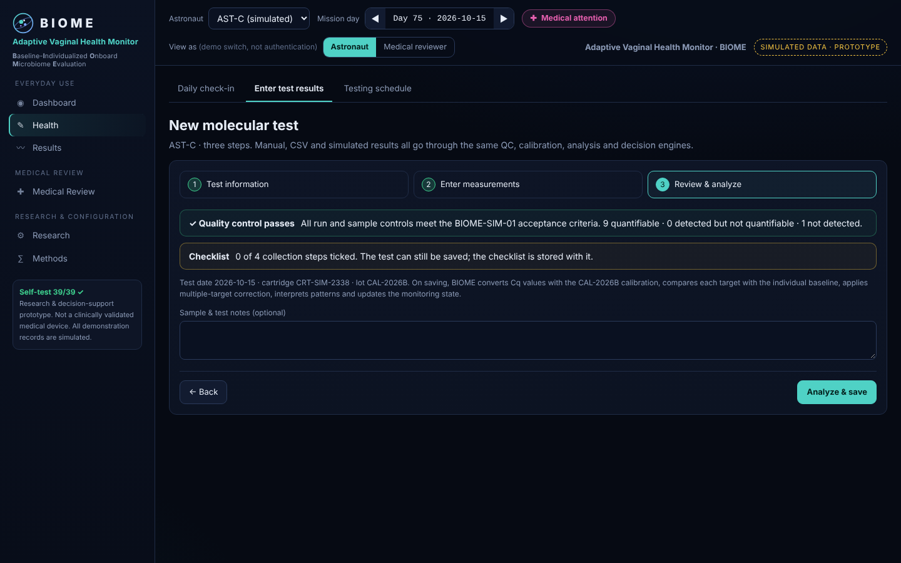

BIOME runs quality control **before** saving and shows a preview:

- **✓ Quality control passes**, with counts of quantifiable, detected-but-not-quantifiable and not-detected targets; or
- **✗ Quality control fails**, with the reasons. The test **will be saved as invalid**. It uses a cartridge, does **not** change the monitoring state, and a repeat collection is scheduled for the next day. **QC results cannot be overridden.**

The preview also warns about:
- an incomplete checklist (the test can still be saved);
- run-specific standard curves;
- an assay that differs from the baseline assay. The result will be recorded but not compared with the baseline.

Add optional **Sample & test notes**, then click **Analyze & save**. If QC failed, the button reads **Save as invalid test**. BIOME opens the new result.

### 4.5 Understanding results

Open **Results → Latest result**. Use **Show another test** (top right) to open any earlier test, including pre-flight samples.

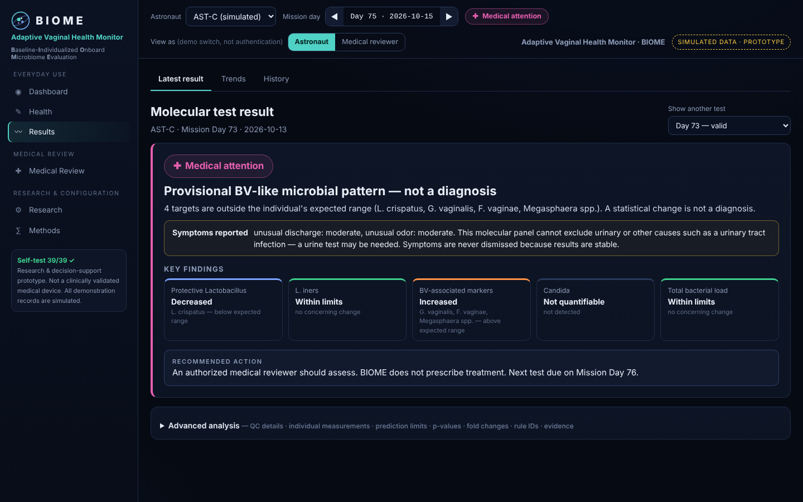

The main result card shows:

1. **Overall status:** the plain-language badge, or *✕ Invalid test*.
2. **Headline and summary in plain language**, e.g. *"Provisional BV-like microbial pattern: not a diagnosis"* followed by which targets are outside the individual's expected range.
3. A **symptoms notice** if symptoms were reported around the test. It reminds the reader that urinary or other causes cannot be excluded by this panel.
4. **Key findings** for five microbial domains:
   - Protective *Lactobacillus*.
   - *L. iners*.
   - BV-associated markers.
   - *Candida*.
   - Total bacterial load.

   Each domain reads *Within limits*, *Increased*, *Decreased*, *Changed*, *Changed (qualitative)*, *Not quantifiable*, *Not assessed* (invalid test), *Recorded* (no approved baseline yet) or *Not compared* (assay differs from the baseline).
5. **Recommended action**, including the **next scheduled test day**.

**Advanced analysis** (expandable) holds the full technical record:

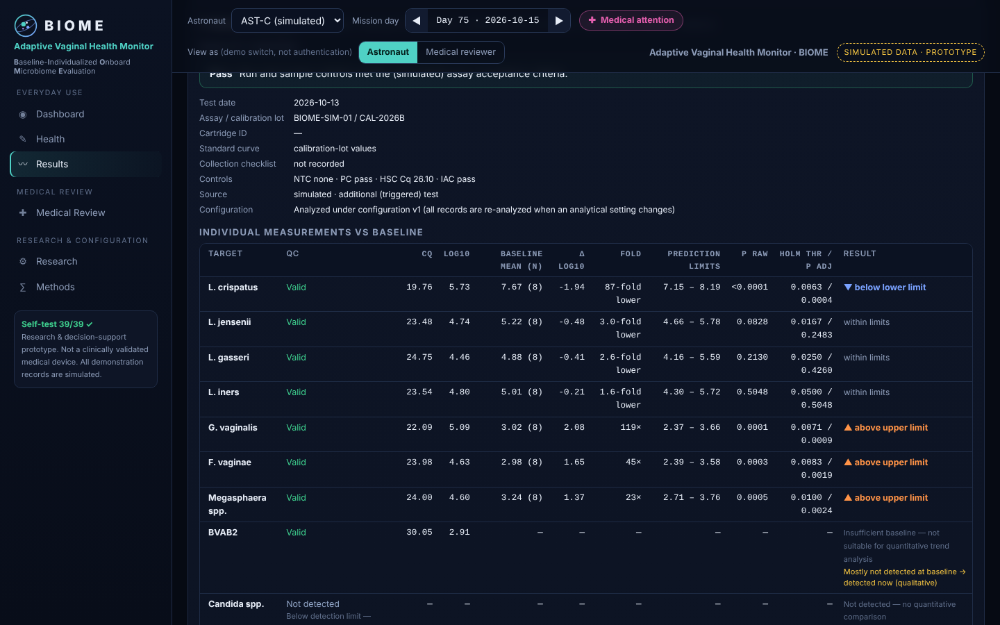

- **QC outcome**, plus the test date, assay and calibration lot, cartridge ID, whether lot or run-specific standard curves were used, the checklist (*n of 4 steps ticked*), sample context, the control values, the data source and the configuration version.
- **Individual measurements vs baseline**, one row per target: QC status, Cq, log10 abundance, baseline mean (n), **absolute log10 change**, **fold change**, **95% prediction limits**, **raw p-value**, **Holm threshold / adjusted p-value**, and the result. The result is one of: above or below the limit, outside the unadjusted limit but not significant after Holm, within limits, or the reason no comparison was possible.
- The **Holm family size** (m) and the significance level.
- **Pattern interpretation**, with the provisional-heuristic label where relevant.
- **Decision rules applied**, grouped into Baseline management, Molecular changes, Symptoms & clinical review, Test quality and Records, with each rule's meaning.
- The **full deterministic explanation** in template-generated text. No language model is used.
- **What this does not mean**, e.g. *"A statistical deviation is not a diagnosis"*, *"This is not a BV diagnosis…"*, *"An increase in Lactobacillus is not deterioration."*
- **Evidence & assumptions** tags.

**Results → History** lists every test with its headline and the status that followed. It also lists every status change with its reason and rule ID.

### 4.6 Viewing longitudinal trends

Open **Results → Trends**. Graphs show how an astronaut's measurements change over time rather than treating each test in isolation. Only one graph is shown at a time, and every graph has a **Show data table** button.

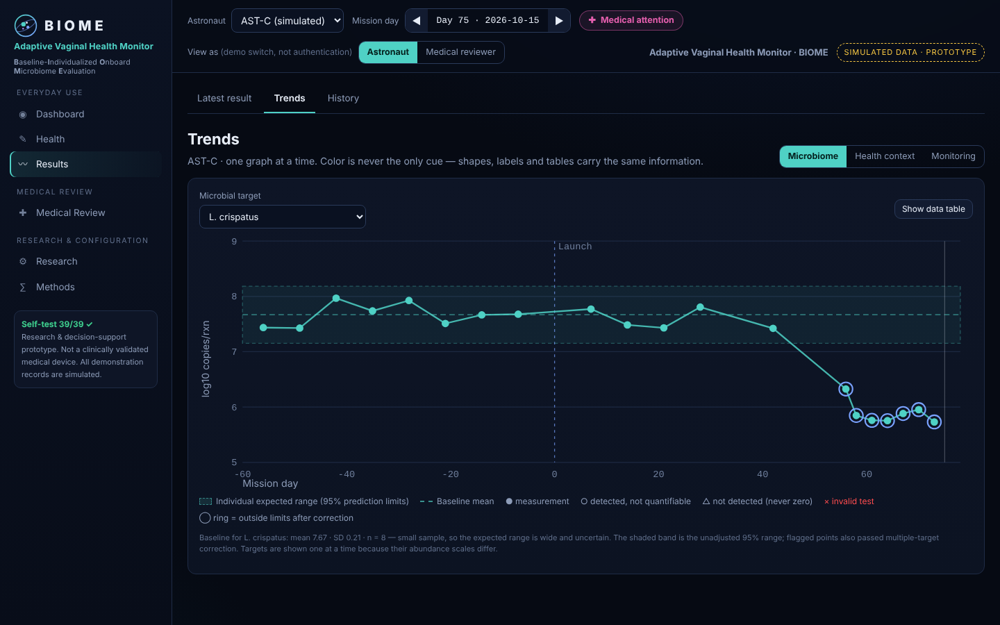

**Microbiome**
- Choose a **Microbial target**. The list is grouped by domain, and targets are shown one at a time because their abundance scales differ.
- The graph covers mission days −60 to the current day. It marks launch (day 0) and the current day.
- The **shaded band** is the individual 95% prediction range from the approved baseline, and the dashed line is the baseline mean.
- Markers: ● quantified measurement; ○ detected but not quantifiable; △ not detected (plotted at the bottom, never as zero); **×** invalid test; a **ring** marks a value outside its limits after multiple-target correction. Hover over a marker to see its details.
- If a target has no sufficient quantitative baseline, the text under the graph says so and changes are shown only qualitatively.

**Health context**
- **Symptoms:** the highest self-reported vaginal-symptom severity per day (0 none to 3 severe). Red marks a red flag. The bar is a display aid, not a score.
- **pH:** readings over time with a reference line at **pH 4.5**, labelled *one Amsel criterion; not diagnostic alone*.
- **Cycle & medication events:** a table of baseline-relevant changes, medication/health updates and cycle-phase changes.

**Monitoring**
- **Monitoring status:** a day-by-day status strip.
- **Test frequency:** each test marked as routine, additional (repeat or increased monitoring) or invalid.
- **Cartridge use:** cumulative cartridges for the selected astronaut, with invalid tests marked.

### 4.7 Advancing the mission timeline

- Click **▶** in the top bar to advance the mission by **one day**.
- For every scenario-based astronaut (AST-A to AST-F), BIOME automatically adds that day's **simulated check-in** from the scenario, unless one already exists for that day.
- Advancing **does not add a molecular test**. When a test falls due, BIOME shows a notification (e.g. *"Repeat molecular test due today"*). The Dashboard's **Next action** card then offers **Enter test results**.
- You must **enter or simulate the test yourself** under Health → Enter test results.
- The earliest mission day you can select is **−60**.

> **Known issue: backward navigation.** The ◀ arrow changes the displayed day, but the decision engine still processes records from later days. The displayed status can therefore reflect events after the selected day. For example, with the presets, stepping AST-C back to day 60 still shows *Clinical Review* (reached on day 66), while her actual state on day 60 was *Monitor*. Do not use ◀ as a historical replay feature until this is fixed (Sections 12.2 and 13).

### 4.8 Medical reviewer interface

Switch **View as** to **Medical reviewer**. This is a demonstration switch, not authentication. In the astronaut view, Review tasks and Baseline management show a prompt to switch role, and other astronauts' statuses are shown as *private*.

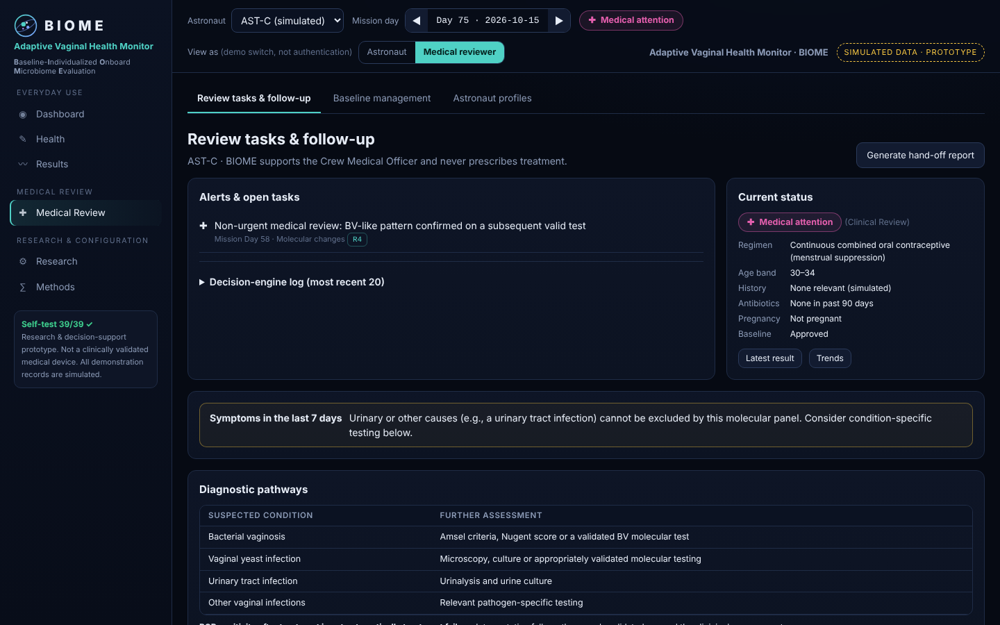

**Medical Review → Review tasks & follow-up**
- **Alerts & open tasks**, each with its rule group and rule ID (e.g. a due repeat test, a symptom-assessment task, a non-urgent BV-like review flag, a Candida contextual review, an urgent flag).
- **Decision-engine log**, expandable, showing the 20 most recent entries with day, rule ID and message.
- **Current status:** the plain-language and internal state, regimen, age band, history, antibiotics, pregnancy status and baseline status, with shortcuts to the latest result and trends.
- A reminder when symptoms were reported in the last 7 days. It notes that urinary or other causes cannot be excluded by the panel.
- **Diagnostic pathways:**

  | Suspected condition | Further assessment |
  | --- | --- |
  | Bacterial vaginosis | Amsel criteria, Nugent score or a validated BV molecular test |
  | Vaginal yeast infection | Microscopy, culture or appropriately validated molecular testing |
  | Urinary tract infection | Urinalysis and urine culture |
  | Other vaginal infections | Relevant pathogen-specific testing |

  The screen also says: *PCR positivity after treatment is not automatically treatment failure.*
- **Generate hand-off report:** a structured plain-text report with status, reason, next action, profile, baseline, open tasks, the last three tests with per-target statistics, and the last seven days of symptoms. Use **⇩ Download .txt** or **Print**.

**Recording a clinical decision** (form on the same tab):

1. Write the **Clinical assessment** (required).
2. Choose a **Disposition**:
   - *Return to routine surveillance* sets Stable.
   - *Continue increased monitoring* sets Monitor.
   - *Remain in Clinical Review*.
3. Choose any **Condition-specific testing**.
4. Enter the **Reviewer (coded)** code. The default is `CMO-1`.
5. Write the **Clinician-entered management plan**. BIOME never generates treatment.
6. Optionally expand **Clinical diagnostic criteria** and record the four **Amsel criteria** (≥ 3 of 4 = Amsel diagnosis) and a **Nugent score** (0–3 *Lactobacillus*-predominant, 4–6 intermediate, 7–10 consistent with BV). These are clinician-entered results. **BIOME never calculates Amsel or Nugent from qPCR.**
7. Record **Follow-up monitoring & outcome**.
8. If an urgent flag is active, tick *Urgent situation assessed: clear the Urgent alert*.
9. Click **Record decision (Mission Day N)**. The decision appears in **Decision history**, and the engine applies the disposition from that day.

**Medical Review → Baseline management**

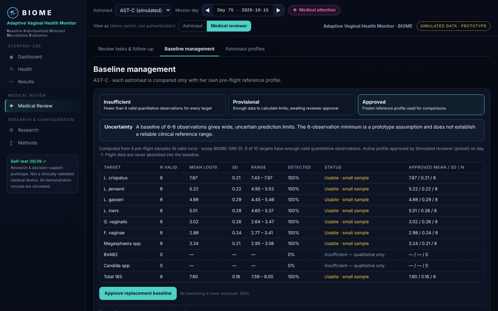

- A three-stage indicator:
  - **Insufficient:** fewer than 6 valid quantitative observations for every target.
  - **Provisional:** enough data to calculate limits, awaiting approval.
  - **Approved:** frozen reference profile.
- An uncertainty notice: 6–8 observations give wide limits, and the 6-observation minimum is a prototype assumption.
- A per-target summary: n valid, mean log10, SD, range, detection percentage and status. Status is *Usable*, *Usable · small sample*, *high variability* or *Insufficient: qualitative only*. When a baseline is active, the approved mean/SD/n are shown alongside.
- **Approve baseline** (or **Approve replacement baseline**). BIOME asks for the reviewer's code, and approval needs at least one usable target. The approved snapshot is **frozen**: flight measurements never change it.
- **Reject baseline**, with a **required reason**. The astronaut stays in Baseline, a *"Collect more baseline data"* task is created and an audit-log entry is written.
- **Keep existing baseline.** This appears when the baseline has been flagged by a baseline-changing event (R10) and records the decision to keep it.
- **Simulate pre-flight collection (8 samples).** This appears for astronauts with fewer than eight baseline samples.
- **Baseline samples & context:** every pre-flight sample with QC, assay/lot, cycle phase, hormonal/medication context and pH.
- **Baseline decisions:** every approval, rejection or keep decision, with reviewer and reason.

Baseline review is triggered when the check-in's *major change* box is ticked. It is also triggered when a reviewer edits an astronaut's regimen, pregnancy status or recent antibiotic/antifungal use, or when a test uses an assay that is not compatible with the baseline.

**Medical Review → Astronaut profiles**
- Cards for every astronaut. Clicking a card selects that astronaut.
- In reviewer view: **Edit** the selected profile (age band, regimen, cycle length, protected pregnancy status, mission start date, recent antibiotic/antifungal use, history, previous diagnoses), **Create astronaut profile**, and **Delete record…** (permanent; it asks for confirmation). Profile management is available only in the reviewer view.

### 4.9 Creating a new astronaut profile

1. Switch **View as** to **Medical reviewer**.
2. Open **Medical Review → Astronaut profiles**.
3. Under **Create astronaut profile**, enter a **Coded identifier** of **2–16 letters, digits or hyphens** (e.g. `AST-G`; it is stored in upper case) and any profile details.
4. Click **Create profile**. BIOME selects the new astronaut and opens Baseline management. The astronaut starts in **Baseline**.
5. Build a baseline in one of two ways:
   - click **Simulate pre-flight collection (8 samples)**, which adds weekly samples on days −56 to −7; or
   - enter tests with **negative mission days** under Health → Enter test results (manually or by CSV).
6. Collect at least **six valid quantitative observations for at least one target**. The stage indicator moves from *Insufficient* to *Provisional*.
7. Click **Approve baseline** and enter the reviewer code. The astronaut moves to **Stable**, and the first in-flight test is scheduled for **mission day 7**.
8. Begin routine monitoring with daily check-ins and in-flight tests.

Six observations is a **prototype requirement**, editable in Advanced settings. It is not a clinically established minimum for vaginal microbiome baselines.

### 4.10 Research section

#### Simulation & benchmarking

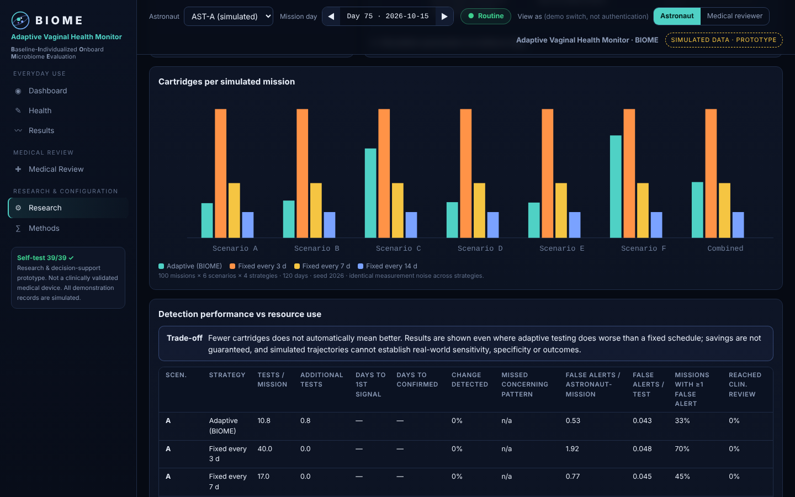

1. Open **Research → Simulation & benchmarking**.
2. Optionally change **Missions per configuration** (default **100**), **Random seed** (**2026**), **Mission length** (**120** days) and **Invalid-test probability** (**0.03**). These settings affect only the simulation.
3. Click **▶ Run benchmark**. The full default run (2,400 simulated missions) takes a few seconds.

The benchmark simulates all **six scenarios** under the **adaptive** schedule and under **fixed schedules of every 3, 7 and 14 days**. For a given mission, every schedule sees **identical simulated measurement noise**. Results appear as a bar chart of tests per mission and a table with these columns:

- Tests / mission and Additional tests.
- Days to 1st signal (median) and Days to confirmed (median).
- Change detected and Missed concerning pattern.
- False alerts / astronaut-mission, False alerts / test and Missions with ≥ 1 false alert.
- Reached Clin. Review.

The simulator also computes the days spent in each monitoring state, but the current table does not display them (Section 12.2).

This is a **simulation of the proposed monitoring logic, not clinical validation**. Read it in terms of both detection performance and resource use. With the default settings:

- In stable scenario A, adaptive monitoring produced at least one false alert in **33%** of simulated missions.
- Scenario B's temporary change was detected in **80%** of adaptive missions, compared with **93%** when testing every 3 days.

The app itself warns: *"Fewer cartridges does not automatically mean better."* Section 7 has the full results.

A **Demonstration presets** table shows each preset's expected behaviour next to the engine's current result. **Simulation parameters & evidence tags** lists every simulation input with its classification.

#### Research archive

Open **Research → Research archive**. It has seven tabs:

| Tab | What it shows |
| --- | --- |
| **Data overview** | Per astronaut: baseline and flight sample counts, valid/invalid tests, check-ins and status. Metadata is filled in from test records automatically. |
| **Sample records** | A de-identified preview of the most recent samples and a list of excluded fields |
| **Assay metadata** | Assay, lot, units, human-sample-control criterion and a curve summary |
| **Export** | Scope (*All astronauts* or the selected astronaut). Options: *Include calendar dates* (off by default; re-identification risk), *Include cycle/hormonal metadata* (on by default, if consent permits), *Include medication context* (off by default). Buttons **⇩ CSV**, **⇩ JSON (study / sample / assay)**, **⇩ Data dictionary** |
| **Data dictionary** | Definition of every exported field |
| **OSDR preparation** | How the export maps to OSDR study-, sample- and assay-level metadata, and what remains required (approved protocol, consent, privacy review, curation) |
| **Backup & records** | **⇩ Backup all data** (full JSON), **⇧ Restore…**, **Reset to demonstration presets…**, and the most recent 40 records for the selected astronaut, each with a **Delete** button |

Private check-in notes and sample notes are **never** included in research exports.

### 4.11 Methods section

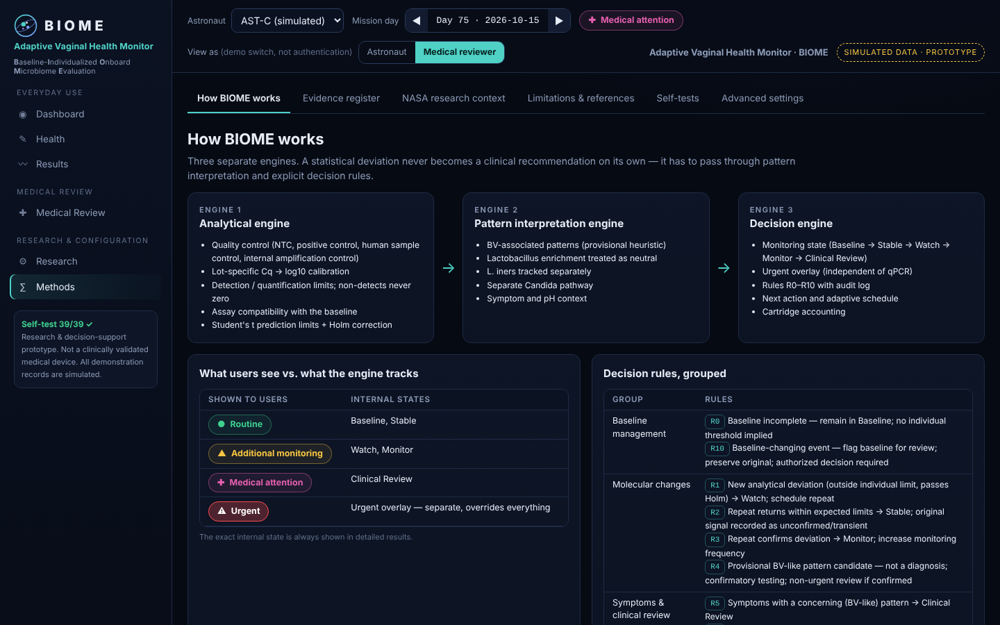

| Sub-tab | Contents |
| --- | --- |
| **How BIOME works** | The three engines (analytical, pattern interpretation, decision), the status-category mapping, the grouped decision rules, a table showing where each specification screen lives, and all formulas and assumptions |
| **Evidence register** | The Hilbert et al. (2016) comparison table with its warnings; every parameter with its value, classification and source; the simulation parameters |
| **NASA research context** | Five hazards, Risks of Human Spaceflight, Host–Microorganism Interactions, ongoing HRP research, UTIs in spaceflight, the female-specific research gap, open science and challenge alignment |
| **Limitations & references** | All limitations, the proposed physical workflow and the reference list |
| **Self-tests** | The current result (39 of 39), each check with group, rule and pass/fail, and a **Re-run** button |
| **Advanced settings** | Prototype configuration (see below) |

**Advanced settings** are **locked** by default. To change one:

1. Click **🔓 Unlock editing…** and confirm.
2. Change a value. BIOME asks you to confirm the old and new values.
3. Confirming creates a new **configuration version** (*Configuration v2, v3…*). The change is recorded in the **Change log** with its previous value, new value and time, and **every astronaut's records are re-analyzed** under the new configuration.
4. **Restore defaults…** resets all analytical settings, also as a new version. **🔒 Lock** makes the settings read-only again.

These are settings for **prototype configuration and experimentation**. They are not clinically approved operating parameters.

---

## 5. How the personalized analysis engine works

This section follows one health assessment or qPCR result from entry to recommendation. BIOME separates three engines on purpose, so that **a statistical deviation never becomes a clinical recommendation on its own**:

1. **Analytical engine:** quality control, calibration, baseline comparison and statistics.
2. **Pattern interpretation engine:** BV-associated patterns, *Lactobacillus*, *Candida* and symptom context.
3. **Decision engine:** monitoring state, rules R0–R10, next action, testing schedule and cartridge accounting.

### 5.1 Overview of the decision pipeline

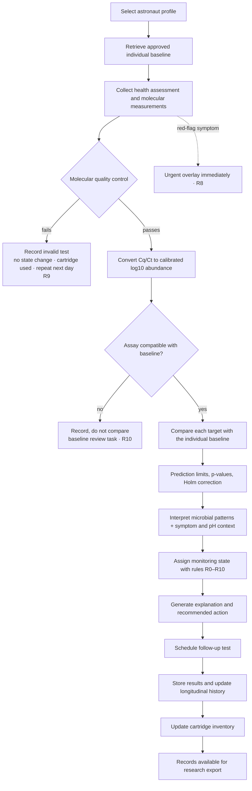

The decision engine **replays an astronaut's whole record in order** (by mission day, then entry order) whenever a record is added, deleted or re-analyzed. The current status therefore always follows from the same deterministic rules applied to the same data, whether the data was typed, imported or simulated.

### 5.2 Quality control

Quality control runs **before** any interpretation, because an unreliable measurement would make every later step unreliable.

| Check | Failure response |
| --- | --- |
| **No-template control** amplified | Run rejected (possible contamination) |
| **Positive control** failed | Run rejected |
| **Human sample control** not amplified, or Cq above the assay criterion (Cq ≤ 32 for SIM-01, ≤ 31 for SIM-02) | Sample rejected: sample adequacy not established |
| **Internal amplification control** inhibited | Rejected under the default policy (`reject`); can be set to `flag` in Advanced settings |
| **Internal amplification control** failed | Run rejected |
| **Assay/calibration information** missing | Run rejected: calibrated abundance cannot be calculated |

If any of these fail, the whole test is **invalid**. Every target is marked *QC failure*, the monitoring state is **not** updated (rule R9), the cartridge **is** counted, and a repeat collection is scheduled for the next day.

Each target in a valid run then gets one of five labels:

| Label | Meaning |
| --- | --- |
| **Valid quantitative result** | Within the validated range; used for statistics |
| **Detected, below quantification limit** | Present but not reliably quantifiable; never used as an ordinary number |
| **Not detected** | Below the detection limit; **recorded as not detected, not as zero** |
| **QC failure** | E.g. above the upper limit of quantification, inconsistent Cq vs entered abundance, or the whole run invalid |
| **Missing** | Not run, no value entered, or an invalid run-specific standard curve |

No value is ever substituted for a non-detect, such as half the detection limit. Fold changes are calculated only from valid quantitative values. A target that moves between "usually detected" and "not detected" (or the reverse) is reported as a **qualitative transition**. "Usually" means at least 50% of valid baseline runs.

### 5.3 qPCR calibration

A qPCR instrument reports the cycle (Cq) at which fluorescence crosses a threshold. More starting DNA gives an earlier crossing. Each assay's standard curve relates Cq to the number of target copies *N*:

$$
\mathrm{Cq} = m \cdot \log_{10}(N) + b
\qquad\Longrightarrow\qquad
\log_{10}(N) = \frac{\mathrm{Cq} - b}{m}
$$

- *N* is the estimated number of target copies per reaction.
- Cq is the measured quantification cycle.
- *m* is the standard-curve slope, which is negative.
- *b* is the intercept.

Calibration depends on the **assay and the lot**. BIOME stores per-target *m* and *b* for every lot. A run can also carry its own user-entered *m* and *b*, and these are used and exported instead. The slope must be negative, otherwise abundance is not calculated. Each target also has:

- a **limit of detection** (LOD; below it, *not detected*);
- a **limit of quantification** (LOQ; between LOD and LOQ, *detected, not quantifiable*);
- an **upper limit of quantification** (ULOQ; above it, *QC failure*).

In the simulated assays these are **1.3**, **2.0** and **9.5** log10 copies/reaction. All calibration values in BIOME are **hypothetical simulation values** that need real assay validation [9]. They are not universal: lots of the same assay are converted with their own curves. A test from a **different assay** (e.g. SIM-02 against a SIM-01 baseline) is **not compared** with the baseline. It needs a validated conversion or a new, reviewed baseline. Raw Cq values are never compared as if they were linear quantities, and copy numbers of different targets are never summed.

### 5.4 Individual baseline establishment

Vaginal microbial communities differ between people and can change naturally over time [5]. A single population "normal range" may therefore misrepresent what is normal for one astronaut. BIOME compares each astronaut with **herself**:

- The demonstration scenarios include **eight weekly pre-flight samples** (days −56 to −7).
- For each target, BIOME uses only **valid quantitative** baseline values to calculate the **mean** and **sample standard deviation** on the log10 scale, plus *n*, the observed range and the detection fraction:

  $$
  \bar{x} = \frac{1}{n}\sum_{i=1}^{n} x_i
  \qquad
  s = \sqrt{\frac{1}{n-1}\sum_{i=1}^{n}(x_i - \bar{x})^2}
  $$

- A target is **usable** only with **at least six valid observations** and a non-zero SD. This is a prototype assumption [configurable]. Below that, the target is compared only qualitatively. With fewer than 9 observations (6 × 1.5) the target is labelled *small sample*, because its limits are wide and uncertain.
- Warnings flag high variability (SD > 0.6 log10) and non-*Lactobacillus*-dominated baselines. These go to review and are **not** classified as abnormal.
- A baseline must be **approved by a reviewer** before comparisons begin. The approved snapshot is **frozen**: flight measurements never update it. Otherwise a slow deterioration could be absorbed into a new "normal".
- Events such as a change in hormonal regimen, pregnancy, a new antibiotic course or an assay change **flag** the baseline for review (R10). They never replace it automatically.

### 5.5 Statistical comparison

For each valid quantitative target with a usable baseline, BIOME asks: *how unusual is this value for this astronaut?*

$$
t = \frac{x_{\text{new}} - \bar{x}}{s\,\sqrt{1 + \frac{1}{n}}},
\qquad
\mathrm{df} = n - 1,
\qquad
p_{\text{raw}} = 2\left[1 - T_{\mathrm{df}}\!\left(|t|\right)\right]
$$

$$
\text{95\% prediction limits} \;=\; \bar{x} \;\pm\; t_{0.975,\,n-1}\cdot s\,\sqrt{1 + \frac{1}{n}}
$$

- *x*<sub>new</sub> is the new log10 abundance. *x̄*, *s* and *n* come from the approved baseline. *T*<sub>df</sub> is the Student's *t* cumulative distribution with *n* − 1 degrees of freedom.
- The √(1 + 1/*n*) term widens the limits to allow for both the uncertainty in the baseline mean and the scatter of a new observation. This is a **prediction interval**: where the astronaut's next value would fall if nothing had changed.
- **Absolute log10 change** = *x*<sub>new</sub> − *x̄*. **Fold change** = 10<sup>(*x*<sub>new</sub> − *x̄*)</sup>. For example, 2× means twice the baseline mean and 0.5× means half. Fold change shows magnitude only. No universal fold-change threshold indicates disease.
- **Holm correction.** One test checks up to ten targets, so some would look unusual by chance. BIOME applies the Holm step-down procedure [14] to all targets with a valid comparison in that test. It sorts p-values from smallest to largest and rejects *p*<sub>(k)</sub> while *p*<sub>(k)</sub> ≤ 0.05 / (*m* − *k* + 1). A target counts as a **signal** only if it passes this correction. The 0.05 level is a **statistical convention**, not a clinical risk threshold.
- **Assumptions:** baseline values are representative, roughly independent, stable over the baseline period and roughly normal on the log10 scale. These are stated in the app's Methods screen.
- **Limitation:** Holm controls false positives **within one test**, not across the many repeated tests of a mission. The benchmark measures that cumulative effect directly (Section 7).

A result outside an astronaut's expected range is a reason for **monitoring and investigation, not a diagnosis**. Reference change values [13] are documented in the app as an alternative method, but they are not combined with the prediction limits, to avoid counting measurement variation twice.

### 5.6 Microbial pattern interpretation

The pattern engine looks at which **direction** targets move and **which domains** move together. It never relies on one target as a diagnosis.

| Domain | Targets |
| --- | --- |
| Protective-associated *Lactobacillus* | *L. crispatus*, *L. jensenii*, *L. gasseri* |
| *L. iners* (separate) | *L. iners* |
| BV-associated | *G. vaginalis*, *F. vaginae*, *Megasphaera*, BVAB2 (optional) |
| *Candida* (separate fungal pathway) | *Candida* spp. |
| Total bacterial load | Total 16S |

| Pattern | Rule in the prototype | Initial response |
| --- | --- | --- |
| Stable pattern | No signals | Routine surveillance |
| **Provisional BV-like microbial pattern: not a diagnosis** | **≥ 2 BV-associated targets above their upper limits *and* ≥ 1 of *L. crispatus*, *L. jensenii* or *L. gasseri* below its lower limit** (after Holm correction) | Confirm and increase monitoring |
| BV-associated increase | ≥ 1 BV-associated target up, BV-like rule not met | Repeat test and assess context |
| *Lactobacillus* enrichment (neutral) | Only increases, in protective *Lactobacillus* and/or *L. iners* (16S may also rise), with no BV-associated increase and no protective decrease | Neutral pattern; monitor |
| Total-load shift | Only total 16S changes | Repeat or monitor |
| *Candida* increase alone | *Candida* rises beyond its limit, or is newly detected, with no bacterial signal | Record and contextualize |
| Mixed or unclear change | Any other combination of signals | Repeat and review if persistent |

- ***L. iners*** never counts as a protective species for the BV-like rule, because it occurs in both healthy and BV-associated communities. An *L. iners* increase alone is treated as part of neutral enrichment, not as deterioration.
- ***Candida*** is evaluated **separately** from bacterial patterns. It never moves an astronaut to Watch on its own (Section 5.7).
- The **BV-like rule is a provisional engineering heuristic**. It is configurable and needs prospective validation. It is **not** a validated diagnosis of bacterial vaginosis, which is diagnosed clinically by Amsel criteria, Nugent scoring or a validated BV test [11].

### 5.7 Monitoring states and actions

| State | Meaning | Prototype response |
| --- | --- | --- |
| **Baseline** | Baseline being established or not yet approved | Continue baseline collection and review (R0) |
| **Stable** | No qualifying concerning change | Routine monitoring |
| **Watch** | A target has a new, Holm-significant deviation | Repeat test in **2 days** (R1) |
| **Monitor** | The same target deviated in the **same direction** on a valid repeat | Increased monitoring, **every 3 days** (R3) |
| **Clinical Review** | Symptoms, or symptoms plus a pattern, require medical assessment | Reviewer assessment; stays until a reviewer records a decision |
| **Urgent overlay** | A red-flag symptom was reported | Immediate escalation; reviewer clearance required (R8) |

**The rules**

| Group | Rule | What it does |
| --- | --- | --- |
| Baseline management | **R0** | No approved baseline: stay in Baseline, record measurements, imply no threshold. Approval moves the astronaut to Stable; rejection keeps Baseline and asks for more data. |
| | **R10** | Baseline-changing event or incompatible assay: flag the baseline for review, preserve it and require a recorded decision. Results while flagged are labelled provisional. |
| Molecular changes | **R1** | Stable → **Watch** on a new signal; repeat scheduled. |
| | **R2** | A valid repeat (or later test) with no bacterial signal → back to **Stable**; the earlier signal is recorded as unconfirmed/transient. |
| | **R3** | Watch → **Monitor** when the same target stays outside its limit in the same direction. A *different* target becoming abnormal is a new signal, **not** confirmation. |
| | **R4** | Provisional BV-like pattern flagged. If it appears on **2 consecutive valid tests**, a non-urgent medical-review task is created. |
| Symptoms & clinical review | **R5** | Vaginal symptoms with a BV-like pattern → **Clinical Review**. |
| | **R6** | Symptoms with stable or non-explanatory results: a symptom-assessment task is created (never dismissed). If symptoms reach the configured triage threshold → **Clinical Review**. |
| | **R7** | *Candida* change without symptoms: recorded and contextualized, no escalation, a contextual review task. With symptoms → **Clinical Review**. |
| | **R8** | Red flag → **Urgent overlay** immediately. |
| Test quality | **R9** | Invalid test: no state change, cartridge used, repeat next day. |

**Symptoms can trigger Clinical Review even when microbial results are stable** (R6). The selected panel cannot exclude all causes of symptoms, for example a UTI or an STI. BIOME therefore creates a symptom-assessment task on the first symptomatic day. It moves to Clinical Review when the **prototype triage placeholder** is met: any symptom rated **Moderate or worse**, or symptoms on **3 consecutive days**. Both values are configurable stand-ins for medically approved mission rules, not universal severity thresholds. The optional **urinary** item creates its own R6 task (*"possible urinary cause; urinalysis suggested"*). It never contributes to R5, R7 or the escalation thresholds.

**Why *Candida* alone does not trigger medical attention.** CDC guidance estimates that roughly 10–20% of women carry *Candida* or other yeasts without symptoms or signs of infection. Detection without symptoms is not an indication for treatment [12]. BIOME records the change and explains it. It escalates to Clinical Review only if relevant symptoms are reported: at a check-in after the *Candida* change, or within the **1-day** symptom–test linking window (configurable) of the test.

**Leaving Clinical Review** requires a recorded reviewer decision (Section 4.8). Tests during Clinical Review are still analyzed and stored.

### 5.8 Monitoring schedule and inventory

| Situation | Next test (prototype default) |
| --- | --- |
| First in-flight test after baseline approval | Mission day 7 |
| First **28** flight days | Every **7** days |
| Routine monitoring after day 28 | Every **14** days |
| Watch | **2** days after the last test (within 48 h) |
| Monitor | Every **3** days |
| Clinical Review | Every 3 days if the latest pattern showed a microbial or *Candida* change; otherwise the routine interval |
| Invalid test | The **next day** |

The **inventory** is a shared crew pool of **180 cartridges** with a **reserve warning at 25**. The Dashboard shows the remaining count and a warning below the reserve, and each astronaut's valid, invalid and additional (triggered) tests are tracked.

All of these are **prototype scheduling and resource assumptions**, configurable in Advanced settings. They are **not** NASA medical protocols or validated clinical intervals. The Earth-based study that motivates repeated sampling used twice-weekly collection [5]. It shows that repeated sampling is valuable, but it does not validate these specific intervals.

---

## 6. Demonstration scenarios A–F

All six astronauts are **simulated**. Each preset is generated by running the **real decision engine day by day**: a molecular test happens only when the engine schedules it. Scenarios therefore show different **decision pathways** through the same code, not prewritten outcomes. They do not represent real astronaut outcomes or establish clinical performance. Select any of them in the top bar, advance the mission day, simulate further tests and inspect the results and trends.

Every preset starts from eight weekly pre-flight samples (calibration lot `CAL-2026A`) and a baseline approved on day −1. In-flight samples use lot `CAL-2026B`, so the lot-specific calibration is exercised. Simulated changes are **illustrative magnitudes** (prototype assumptions), and AST-B's change is deliberately exaggerated so it is easy to see.

| Scenario | Demonstration purpose |
| --- | --- |
| A | Stable microbiome and invalid-test handling |
| B | Temporary *L. crispatus* increase and recovery |
| C | Persistent BV-associated changes followed by symptoms |
| D | Symptoms despite stable microbial measurements |
| E | *Candida* detection without symptoms |
| F | *Lactobacillus* enrichment without BV-associated increases |

**A: Stable microbiome and invalid-test handling.** Natural cycle (~28 days).
- **What happens:** no microbial change and no symptoms. On day 56 the human sample control fails.
- **How BIOME responds:**
  - Tests run weekly to day 28, then every 14 days.
  - The day-56 test is saved as **invalid** (R9). The state stays Stable, one cartridge is counted and a repeat is collected on day 57.
- **Demonstrates:** routine surveillance, and that QC failures neither change the state nor go unaccounted.

**B: Temporary *L. crispatus* increase and recovery.** Levonorgestrel IUD.
- **What happens:** *L. crispatus* is 1.5 log10 higher on days 40–43 only.
- **How BIOME responds:**
  - The day-42 routine test shows a Holm-significant increase: **Stable → Watch** (R1), repeat in 2 days.
  - On day 44 the value is back within limits: **Watch → Stable** (R2), signal recorded as unconfirmed/transient.
- **Demonstrates:** confirmation testing that avoids escalating a one-off change.

**C: Persistent BV-associated changes followed by symptoms.** Continuous combined oral contraceptive.
- **What happens:** from day 50, over 8 days:
  - *G. vaginalis*, *F. vaginae*, *Megasphaera* and BVAB2 rise.
  - *L. crispatus* and *L. jensenii* fall.
  - pH rises.

  Mild discharge and odor begin on day 66 and become moderate by day 70.
- **How BIOME responds:**
  - Day 56: **Watch** (R1) with a provisional BV-like pattern (R4).
  - Day 58: the repeat confirms it, **Monitor** (R3). The BV-like pattern on two consecutive tests creates a non-urgent review task (R4), and testing moves to every 3 days.
  - Day 66: vaginal symptoms plus the BV-like pattern move the astronaut to **Clinical Review** (R5).
  - BVAB2 was not detected at baseline, so it appears as a qualitative "newly detected" transition. pH above 4.5 is logged as context only.
- **Demonstrates:** multi-marker pattern detection, confirmation, increased monitoring and symptom-triggered referral, without ever calling it BV.

**D: Symptoms despite stable microbial measurements.** Natural cycle (~30 days).
- **What happens:** the microbiome stays stable. Mild itching starts on day 30, mild burning on day 31, and itching becomes moderate on day 33. On day 21 the internal amplification control shows inhibition.
- **How BIOME responds:**
  - Day 21: **invalid** (R9), repeat on day 22.
  - Day 30: a symptom-assessment task is created (R6).
  - Day 32: the third consecutive symptomatic day meets the triage placeholder, so **Clinical Review** (R6).
- **Demonstrates:** symptoms are never dismissed because molecular results are stable.

**E: *Candida* detection without symptoms.** Etonogestrel implant.
- **What happens:** *Candida* is quantifiable at baseline and rises by 2.4 log10 over days 35–40. No symptoms occur.
- **How BIOME responds:** from the day-42 test the pattern is **"Candida increase alone"**. Each such test is recorded and explained (R7), and one contextual review task is created. The astronaut stays **Stable** and never enters Watch or Clinical Review.
- **Demonstrates:** asymptomatic *Candida* is not automatically escalated [12].

**F: *Lactobacillus* enrichment without BV-associated increases.** Continuous combined oral contraceptive.
- **What happens:** *L. crispatus*, *L. jensenii* and *L. gasseri* rise from day 36. The direction follows the parabolic-flight observation [4]; the magnitude is assumed.
- **How BIOME responds:**
  - Day 42: **Watch** (R1).
  - Day 44: confirmed, **Monitor** (R3), every 3 days.
  - Each result is classified as **neutral *Lactobacillus* enrichment**. No BV-like flag or Clinical Review is ever raised.
- **Demonstrates:** an increase in *Lactobacillus* is not treated as deterioration. Confirmed neutral changes still use extra cartridges under the spec's rules, which the benchmark shows (Section 7).

---

## 7. Simulation and benchmarking

### Why compare adaptive and fixed testing?

The central idea of BIOME is **adaptive monitoring**: test routinely, and add tests only when a result needs confirming or following. A fixed schedule is simpler and more predictable. Testing more often finds changes sooner but uses more consumables and produces more false alerts. Testing less often saves cartridges but risks missing or delaying detection. The benchmark makes these trade-offs visible rather than assuming adaptive testing is better.

### How the benchmark works

- **Scenarios:** A–F, using the same scenario models as the presets. Each simulated mission draws a new individual baseline (means jittered by about ±0.3 log10).
- **Schedules:** adaptive (the real decision engine) and fixed every 3, 7 and 14 days. Under fixed schedules the engine still classifies results, but the schedule ignores the state.
- **Common random numbers:** for a given mission, every schedule sees **identical measurement noise and invalid-test events**, so differences come from the schedule, not from luck.
- **Defaults:** **100** missions per scenario per schedule (2,400 missions), **120** days, seed **2026**, **3%** invalid-test probability. Each mission has 8 pre-flight samples with a baseline approved on day 0 and daily symptom check-ins.

| Parameter | Value | Classification |
| --- | --- | --- |
| Individual baseline abundance | Per-target means for a *L. crispatus*-dominated community, ±0.3 log10 per astronaut | Prototype assumption |
| Within-person biological variation | SD 0.15–0.24 log10 per target | Prototype assumption |
| Assay measurement noise | SD 0.2 Cq (≈ 0.06 log10) | Prototype assumption |
| Cq conversion | Lot-specific *m*, *b* | Calculated from other parameters |
| Scenario shifts | e.g. B: +1.5 log10 *L. crispatus* for 4 days | Prototype assumption (illustrative) |
| Direction of enrichment in F | *L. crispatus* / *L. jensenii* increase | Evidence-based direction [4]; magnitude assumed |
| Invalid-test probability | 3% per test | Prototype assumption |
| Missions per configuration | 100 | Simulation setting, not a sample-size recommendation |

### Outcome metrics

- **Tests per mission** and **additional tests** (repeat, increased-monitoring and invalid-repeat tests).
- **Days to first signal** and **days to confirmed signal**: medians, measured from the scenario's simulated onset, counting only signals on targets that actually changed.
- **Change detected:** the share of missions in which the real change produced a signal.
- **Missed concerning pattern:** scenario C only; no BV-like pattern during the mission.
- **False alerts:** signals in a scenario, period or target with no simulated change. They are counted across **all repeated tests in the mission** and reported per astronaut-mission, per test, and as the share of missions with at least one.
- **Reached Clinical Review.**

### Results with default settings (seed 2026)

| Scenario | Schedule | Tests / mission | Change detected | Days to 1st signal | Missions with ≥ 1 false alert |
| --- | --- | --- | --- | --- | --- |
| A (stable) | Adaptive | 10.8 | — | — | **33%** |
| | Every 3 d | 40.0 | — | — | 70% |
| | Every 7 d | 17.0 | — | — | 45% |
| | Every 14 d | 8.0 | — | — | 29% |
| B (temporary) | Adaptive | 11.6 | **80%** | 2 | 30% |
| | Every 3 d | 40.0 | **93%** | 2 | 50% |
| | Every 7 d | 17.0 | 92% | 2 | 38% |
| | Every 14 d | 8.0 | 94% | 2 | 24% |
| C (BV-like + symptoms) | Adaptive | 27.8 | 100% (0% missed) | 6 | 13% |
| | Every 3 d | 40.0 | 100% (0% missed) | 4 | 45% |
| | Every 7 d | 17.0 | 97% (0% missed) | 6 | 19% |
| | Every 14 d | 8.0 | 99% (0% missed) | 6 | 8% |
| F (enrichment) | Adaptive | 31.8 | 100% | 6 | 17% |
| | Every 3 d | 40.0 | 99% | 3 | 37% |
| | Every 14 d | 8.0 | 97% | 6 | 11% |
| All scenarios | Adaptive | 17.3 | — | 6 | 22% |
| | Every 3 d | 40.0 | — | 4 | 45% |
| | Every 7 d | 17.0 | — | 6 | 26% |
| | Every 14 d | 8.0 | — | 6 | 15% |

The app shows the full table, including scenarios D and E, days to confirmed signal, false alerts per test and Clinical Review rates. "Change detected" is left blank for the combined row because scenarios A and D contain no microbial change to detect.

### What the results show

- **Adaptive testing is not universally better.** For scenario B's short-lived change, adaptive testing detected the change in **80%** of missions. Every fixed schedule did better (92–94%), and testing every 3 days reached **93%**. Adaptive testing follows the 14-day routine after day 28. Invalid tests and earlier false alerts shift its test days, so a 4-day change can fall between tests.
- **False alerts accumulate over a mission.** Even in stable scenario A, a third of adaptive missions produced at least one false alert. Testing every 3 days raised that to 70%. Each false alert costs one extra test and resolves with R2. This is the repeated-testing limitation of per-test Holm correction (Section 5.5).
- **Resource use depends on the scenario.** For stable astronauts, adaptive testing uses about as many cartridges as a 14-day schedule. For confirmed persistent changes (C and F) it uses far more (28–32 per mission), approaching the 40 of a 3-day schedule. In F, that cost is spent following a change classified as neutral.
- **Fixed 14-day testing detected most changes** in these scenarios, but confirmation took much longer, e.g. a median of 20 days in F against 8 for adaptive.

The benchmark is a tool for **exploring design trade-offs and finding weaknesses**: the confirmation rule, the routine interval and how neutral changes are handled. It does **not** establish real-world sensitivity, specificity, safety or resource savings.

---

## 8. Technical architecture and implementation

### 8.1 Technology

| Aspect | Implementation |
| --- | --- |
| Languages | HTML5, CSS3 and JavaScript (ES2020+), with no build step |
| Files | One self-contained file, `index.html` (about 1,850 lines, about 250 KB), holding all markup, styles and scripts |
| External libraries | **None.** No frameworks, chart libraries, web fonts or CDNs. The only external URLs are reference links that open when clicked. |
| Statistics | Implemented directly: Student's *t* CDF via the regularized incomplete beta function (Lanczos log-gamma and a continued fraction), inverse *t* by bisection (cached), Holm step-down, mean/SD |
| Random numbers | Seeded PRNG (`mulberry32`) keyed by an FNV-1a hash of scenario, seed, day and test index, which makes simulations fully reproducible |
| Charts | Hand-written SVG generated in JavaScript: line/marker charts with prediction bands, bar charts, a state strip, hover tooltips and table equivalents |
| Storage | Browser **IndexedDB** (`biome-db`, object stores `astronauts` and `meta`) |
| Interface | Rendered from template strings into a single page; event delegation through `data-act` attributes; no routing library |

### 8.2 Architecture

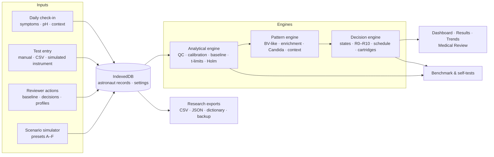

- **Records, not results, are stored.** Each astronaut is one record holding her profile, tests, check-ins, events (baseline-changing changes) and reviews (approvals, rejections, decisions), each with a sequence number. Results are **recalculated** by replaying the record through the engines whenever something changes. That is how a settings change re-analyzes every astronaut, and it guarantees that presets and manual data share one code path.
- **Analytical engine:** `qcTest`, `computeBaseline`, `analyzeTest`. **Pattern engine:** `classify`. **Decision engine:** `Engine` class and `runEngine`, a day-by-day replay that produces states, an audit log, tasks, the schedule and cartridge counts. Explanations come from deterministic templates (`explain`, `notMeaning`).
- **Configuration** is one object with documented defaults. The current settings, configuration version and change log are stored in the `meta` store.

### 8.3 Storage and offline behaviour

- All records are stored **locally in the browser** with IndexedDB and persist across reloads. Nothing is sent to a server.
- If IndexedDB is blocked or unavailable (for example in some private-browsing modes), BIOME **falls back to in-memory data** and the left navigation shows *"IndexedDB unavailable: data held in memory only."* Data is then lost when the page closes.
- Once loaded, BIOME makes **no network requests**. A downloaded copy of `index.html` runs entirely offline. The hosted GitHub Pages version needs a connection for the first load, and the app has no service worker, so reloading it offline depends on the browser's cache.

### 8.4 Import and export

- **CSV import** (`parseTestCSV`): plain comma-separated text with a header row (Section 4.4).
- **CSV export:** one row per sample × target, with sample metadata, QC, Cq, log10 abundance, limits and curve parameters.
- **JSON export:** `study`, `samples`, `assays`, `measurements`, `dataDictionary` and `provenance` (software version, configuration version, export time, excluded fields).
- **Backup/restore:** a full JSON file of all astronauts, settings and mission day (format `biome-backup`, version 2).
- **Hand-off report:** plain text (`.txt`).

### 8.5 Self-test framework

`runSelfTest` runs about 60 ms after every page load. It generates **fresh copies** of the six presets in memory, so your own edits do not affect the tests, and checks them along with known synthetic inputs. Results appear in the left navigation and in Methods → Self-tests (Section 10.1).

### 8.6 Repository structure

```text
biome/
├── index.html              # the complete application
├── README.md               # this file, a comprehensive app description
└── docs/
    └── screenshots/        # interface screenshots used in this README
```

---

## 9. Scientific basis and NASA research context

Each method and number in BIOME is labelled as one of: **Published evidence**, **Calculation from published methods**, **Prototype assumption** or **Simulation parameter**. The app's Evidence register lists them all.

### Female reproductive health research in spaceflight
Evidence on female reproductive health in spaceflight remains limited. Only five of 16 identified studies included women [1], and important gynecological questions remain open [2]. BIOME's motivation rests on this gap, not on a demonstrated harm. *(Published evidence.)*

### Vaginal microbiome variability and longitudinal monitoring
Vaginal communities vary in stability between women and over the menstrual cycle, and change is not the same as dysbiosis [5]. This supports three design decisions: individual baselines, recording of cycle and hormonal context, and confirmation by repeat testing. *(Published evidence → design decision.)* The specific intervals are **prototype assumptions**.

### Spaceflight and host–microorganism interactions
NASA identifies host–microorganism interactions as a spaceflight risk with incompletely understood health implications [3]. The 2026 parabolic-flight study found larger vaginal than oral microbiome changes in four women [4]. It cannot establish persistence, clinical significance or effects in long-duration flight.

NASA's Human Research Roadmap holds the agency's human health and performance risks and their evidence reports [16]. The Human Research Program conducts ongoing research using ground facilities, the ISS, Artemis missions and analogs [17]. Urinary tract infection is among the sex-dependent in-flight conditions modeled in a probabilistic risk assessment of missions of different lengths [15]. This is context for BIOME's urinary referral pathway, not a feature BIOME assesses. NASA material provides **spaceflight health context only**; it is not a source of vaginal qPCR reference ranges for BIOME.

### Molecular testing and qPCR
Converting Cq with assay- and lot-specific standard curves, enforcing detection and quantification limits, and refusing to treat non-detects as zero all follow MIQE 2.0 reporting expectations [9]. *(Calculation from published methods.)* The numerical calibration values and limits are **simulation parameters**.

### BV-associated patterns and diagnostic limitations
Hilbert et al. (2016) evaluated 385 vaginal specimens from 146 women and developed an assay-specific qPCR model to support the diagnosis of **symptomatic** BV [10]:

| Target or model | Published cutoff | Sensitivity | Specificity |
| --- | --- | --- | --- |
| *G. vaginalis* | 1.10 × 10⁵ copies/reaction | 83.6% | 84.1% |
| *A. vaginae* | 1.10 × 10⁵ copies/reaction | 87.1% | 90.7% |
| BVAB2 | 1.00 × 10³ copies/reaction | 78.9% | 92.5% |
| Combined *G. vaginalis* + *A. vaginae* + BVAB2 | 1.17 × 10⁶ copies/reaction | 91.2% | 93.0% |
| BIC logistic-regression model | Predicted probability 0.20 | 91.8% | 95.3% |

These values belong to that study's assays, units, population and diagnostic classification, so they are **not transferred** to BIOME's proposed panel. The BIC model needs *Megasphaera* phylotypes 1 and 2 measured separately, which this panel does not do. The paper's notation is also inconsistent: it describes the linear predictor as the log-odds but converts it to a probability as if it were the odds. The model must not be implemented from the published equation. BIOME's own BV-like rule is a **prototype assumption**.

Clinical BV diagnosis uses Amsel criteria (≥ 3 of 4: homogeneous thin discharge, clue cells, pH > 4.5, positive whiff test) or Nugent scoring (0–3, 4–6, 7–10) [11]. CDC guidance states that BV nucleic-acid amplification tests are primarily for symptomatic women, because their accuracy in asymptomatic women is not well established [11]. BIOME therefore never diagnoses or recommends treatment for asymptomatic microbial deviations.

**Other qualifications built into BIOME**
- *Candida* detection alone does not establish symptomatic infection [12].
- Vaginal pH is context, not a standalone diagnosis. Vulvovaginal candidiasis is commonly associated with normal pH [12].
- A microbial deviation does not necessarily indicate disease.

### Individual biological variation and statistical change detection
The prediction-interval method and the Holm procedure [14] are **published statistical methods**. The 0.05 level is a **statistical convention**. The 6-observation minimum, the 1.5× small-sample label, the 50% detection-fraction cutoff and the 1-day symptom–test linking window are **prototype assumptions**. Reference change values [13] are documented as an alternative method but not combined with the prediction limits.

### NASA medical-care limitations and exploration risks
NASA frames human spaceflight risks around five hazards: space radiation, isolation and confinement, distance from Earth, gravity fields and hostile/closed environments [18]. BIOME's offline operation, onboard analysis, private-by-default records and cartridge accounting respond to the distance and isolation hazards. *(Design rationale.)*

### NASA Open Science Data Repository
OSDR submissions involve study-level information, sample- and assay-level metadata, associated data files and curation review [7, 8]. BIOME's export is organized along those lines. Any real contribution would need an approved study, consent, de-identification and OSDR curation.

### Challenge alignment

| Challenge asks for [6] | BIOME |
| --- | --- |
| Gather astronaut health indicators | pH, symptoms, hormonal context, qPCR |
| Let astronauts assess their health | Individual baselines; plain-language status |
| Help decide what to do | Next action, repeat testing, medical-review prompts |
| Display changing information | Interactive trend graphs with table views |
| Explain measurements and risks | Result explanations, methods, evidence register |
| Support long-duration missions | Offline operation, local storage, cartridge inventory |
| Support medical decisions | Reviewer interface and hand-off report |

---

## 10. Validation and testing

### 10.1 Software testing

The built-in self-test currently reports **39/39 passing**. To re-run it, open **Methods → Self-tests** and click **Re-run**.

| Group | Checks | What is verified |
| --- | --- | --- |
| Statistics | 6 | Mean/SD, *t* CDF, *t* critical value, prediction limit, Holm step-down, fold change |
| QC | 4 | Cq → log10 conversion, non-detect ≠ zero, NTC rejection, Cq/abundance inconsistency |
| Presets | 7 | A never enters Monitor; A's invalid test does not change state; B returns to Stable; C reaches Clinical Review via R5; D reaches Clinical Review via R6 with stable qPCR; E never escalates on *Candida*; F is never classified as harmful |
| Engine | 6 | Red flag → Urgent; incomplete baseline stays in Baseline; baseline-changing event flags without auto re-baselining; deterministic replay; a different abnormal target is not confirmation; incompatible assay is not compared |
| Simulation | 1 | Reproducible random seeds |
| Transitions | 7 | Stable → Watch, Watch → Stable, Watch → Monitor, invalid test, Monitor → Clinical Review, Baseline → Stable on approval, baseline rejection. Each asserts the **state, rule ID, recommendation text, next action and audit-log entry** |
| Urinary | 4 | A urinary symptom creates an R6 task with a urinalysis prompt; it does not trigger R5; each of the two urinary red flags triggers R8 |
| Application | 4 | CSV parsing; run-specific standard curve used for conversion; cartridge count includes invalid tests; astronaut records stay isolated |

The six scenarios exercise different decision pathways through the same engine (Section 6). Together with these checks, they cover the specification's acceptance tests for:
- the shared engine for presets and manual data;
- invalid-test handling;
- non-detects;
- baseline calculation from valid quantitative values only;
- Holm correction;
- log10 fold changes;
- rule IDs on every recommendation;
- record isolation;
- cartridge accounting.

Data persistence, graph updates, exports, offline operation and keyboard operation have been checked by hand in Chrome.

### 10.2 Analytical validation still required (Proposed panel and hardware)

- Assay sensitivity and specificity for each target.
- Calibration accuracy and linear range; real *m*, *b*, LOD, LOQ and ULOQ.
- Repeatability and reproducibility, within and between lots and instruments.
- Sample adequacy and the human-sample-control criterion.
- Sample handling, containment and storage in microgravity; reagent stability.
- Instrument performance and reliability in flight.
- Interference, inhibition and contamination testing.

### 10.3 Clinical validation still required

- Comparison with established diagnostic methods (Amsel, Nugent, validated BV, yeast and UTI tests).
- Validation in relevant populations, including longitudinal data from analog and flight settings.
- Evaluation of asymptomatic monitoring, given CDC's caution about asymptomatic BV testing [11].
- Real-world false-positive and false-negative rates, including the cumulative false alerts seen in the benchmark.
- Medically approved triage rules, red-flag lists and medical-review protocols.

**Passing software tests does not mean the medical system is clinically validated.** The self-tests show that the code does what the specification says. They say nothing about whether the specification is clinically correct.

---

## 11. Privacy, data management and research contribution

- **Local storage only.** Records stay in the browser's IndexedDB on the device that entered them.
- **Coded identifiers.** Astronauts are identified by codes (e.g. `AST-C`), samples by pseudonymous IDs, and names are never requested or stored. A code is pseudonymization, not anonymity: mission dates, cycle information and other metadata can still create re-identification risk.
- **Separation.** Each astronaut is a separate record. Within it, profile, samples (tests), health assessments (check-ins), baseline-changing events and reviewer decisions are stored as separate lists. A self-test confirms that one astronaut's records never affect another's.
- **Private by default.** In the astronaut view, other astronauts' statuses are hidden, and BIOME never sends health information to other crew members.
- **Backup and restore** of the full database as JSON. **Explicit deletion** of individual records or whole astronauts.
- **Research exports** (CSV and JSON) with a **data dictionary** and **provenance**:
  - private notes are always excluded;
  - calendar dates and medication context are excluded unless the exporter opts in;
  - cycle metadata can be switched off.
- **Before any real research contribution:** an approved research protocol, informed consent, de-identification and privacy review, correct sample and assay metadata, and NASA OSDR curation and acceptance would all be required. OSDR is a **potential future destination** only [7, 8].

**Limitations.** Browser storage is **not certified medical-record storage**. The reviewer switch is **not authentication**: anyone using the browser can switch roles. BIOME must not be used to store real identifiable health information.

---

## 12. Limitations and known issues

### 12.1 Limitations

- **No clinical diagnosis or automated prescription.** BIOME supports, and never replaces, clinical assessment.
- **No validated, flight-ready hardware.** The swab-to-qPCR workflow and panel are proposed.
- **No real astronaut vaginal microbiome dataset.** All demonstration data, scenarios and calibration values are simulated.
- **Provisional BV-like logic.** The pattern rule is an engineering heuristic that needs prospective validation.
- **Assay-specific calibration still requires validation.** LOD, LOQ, ULOQ, curves and control criteria are placeholders.
- **Baseline uncertainty.** Prediction limits need adequate repeated baseline observations and reliable assay performance. Six observations give wide, uncertain limits.
- **Repeated testing.** Holm correction controls false positives within one test, not across a mission. The benchmark shows false alerts in a third of stable adaptive missions.
- **Prototype scheduling and triage assumptions.** Intervals, triage thresholds and red-flag lists are not medically approved.
- **Local browser storage** is not a certified medical-record system, and the **reviewer view is not secure authentication**.
- **Benchmark results are simulated** and show no real-world clinical performance or outcome improvement.
- **No UTI diagnosis or risk assessment.** The panel does not assess urinary tract infection; urinary symptoms are recorded for referral only.

### 12.2 Known issues

| # | Issue | Effect | Preferred fix |
| --- | --- | --- | --- |
| 1 | **Backward navigation does not rewind the engine.** ◀ changes the selected day, but records after that day are still processed. | The displayed status can reflect later events (e.g. AST-C at day 60 shows Clinical Review instead of Monitor). | Make the engine ignore records after the selected mission day. Until then, do not present ◀ as historical replay. |
| 2 | **No CSV template download button.** The template generator exists in code but is not linked in the interface. | Users must build the CSV header from Section 4.4. | Restore a "CSV template" button in test-entry step 2. |
| 3 | **Simple CSV parsing.** Fields are split on commas without quote handling. | Notes or values containing commas break a row. | Use an RFC 4180-compliant parser. |
| 4 | **Time in each state is not displayed in the benchmark table.** It is computed by the simulator. | The specification's "time spent in each monitoring state" metric is not visible. | Add the column or a chart. |
| 5 | **No service worker.** | Offline reload of the hosted version depends on the browser cache. | Add a service worker and web app manifest. |

---

## 13. Roadmap and future development

**Software (Future development)**
- Make the decision engine respect the selected historical day (known issue 1).
- Restore the CSV template download, add robust CSV parsing and show time-in-state in the benchmark (known issues 2–4).
- Add a service worker for full offline reloads (known issue 5).
- Real authentication and role-based access, and encrypted storage suitable for health data.
- Study whether the confirmation rule and routine interval can reduce missed transient changes (scenario B) and cumulative false alerts without excessive cartridge use. Examine how confirmed neutral enrichment should affect testing frequency.
- Fuller research-data preparation: OSDR-ready file formats, richer provenance and study metadata.

**Science and validation (Future development)**
- Analytical validation of a real assay panel, including *Megasphaera* phylotype resolution and a validated *Candida* assay (Section 10.2).
- Clinical validation against established diagnostic methods, and longitudinal data from analog and flight settings (Section 10.3).
- Medically approved triage rules and red-flag lists.

**Hardware (Proposed)**
- Development and testing of the swab, sample-preparation and compact qPCR cartridge workflow for microgravity: collection, containment, liquid handling, reagent storage, waste, reliability and crew workload.

No completion dates are given. Not every proposed item will necessarily be implemented.

---

## 14. Installation and usage

**Option 1: Live website.** Open https://olanbonk.github.io/biome/ in a current desktop browser. 

**Option 2: Local copy.**
1. Clone or download the repository:
   ```bash
   git clone https://github.com/olanbonk/biome.git
   ```
2. Open `index.html` directly in a browser by double-clicking it. **No build step, server or installation is needed**, and BIOME works without an internet connection.
3. Optionally, serve the folder with any static server, e.g. `python3 -m http.server`, and open `http://localhost:8000`.

**Browsers.** BIOME was developed and tested in Google Chrome on desktop. It uses standard web features (IndexedDB, SVG, ES2020 JavaScript) supported by the current version of Chrome. When opened as a local file, a few browsers or privacy modes might block IndexedDB. BIOME then keeps data in memory only and shows a warning. Use a local server or another browser if you need persistence.

**Your data.** Records are stored only in the browser you use, separately for each site address (the live site and a local file keep separate data). To start over, use **Research → Research archive → Backup & records → Reset to demonstration presets…**. To move data between browsers, use **⇩ Backup all data** and **⇧ Restore…**.

**Next step:** follow the user guide in [Section 4](#4-how-the-website-works-complete-user-guide), starting with the guided steps in the Dashboard's *Demo guide for judges*.

---

## 15. Team Pigeon and project goals

As a team of three, we hope BIOME shows that women’s health in space is a shared concern, not a niche one. Our goal is to give future crews a personalized way to catch health changes early, so that a woman heading to the Moon or Mars can be confident her care was designed around her. We hope our project helps close the gap in female-specific spaceflight data and encourages more people, of every background, to help close it. Not only that, we hope to show that a small team can turn our research into a practical idea that makes long-duration exploration safer, more inclusive, and better supported by evidence. We know BIOME is a proposal that needs validation, and we hope it starts a conversation that leads to real research and, one day, healthier journeys for everyone who goes.

Our goals are:

- **To make female-specific spaceflight health research more visible**, by showing how much remains unknown and how a structured, longitudinal approach could start to close the gap.
- **To develop a personalized monitoring concept for future crews.** It compares each astronaut with herself, avoids overreacting to single results, explains its reasoning and leaves clinical decisions to clinicians.
- **To argue for inclusive medical research in space exploration**, so that data on women's health are gathered deliberately rather than by chance.

BIOME is a **proposal and a software prototype**. Its physical testing system, molecular panel, thresholds and clinical usefulness all need further research and validation before it could support real astronauts.

---

## 16. AI use, acknowledgements and references

### AI-use disclosure

All ideation was done by our team without the use of AI, only using Artificial Intelligence (including ChatGPT and Claude) to help list out pros and cons for our idea candidates to help narrow down which to use. Most research, including sources regarding the effects of microgravity on the reproductive system and especially on the vaginal microbiome was found by us directly. AI, Claude in particular, was used to help find thresholds for acceptable values for individual bactermium or fungi in the vaginal microbiome to help make decisions in the code. For example, if Lactobacillus crispatus values are high, at  what point should the high value illicit intervention from the Crew Medical Officer. Claude was primarily used in the writing and debugging of both `index.html` and `README.md` under our close supervision. We would write outlines for how the code should read/be run, then have Claude draft the document itself. Afterwards, we would still have to review all generated code and text to ensure correctness and alignment with our ideas.

### Acknowledgements

- NASA Space Apps Challenge 2026 and the *Create Health Monitoring Software for Astronauts on Space Missions* challenge [6].
- NASA Human Research Program, Human Research Roadmap and OSDR resources [3, 7, 8, 16–18].
- The authors of the scientific and clinical literature cited below.
- No external software libraries are used in `index.html`.

### References

1. Gimunová, M., Paludo, A. C., Bernaciková, M., et al. (2024). The effect of space travel on human reproductive health: a systematic review. *npj Microgravity*, 10, 10. https://doi.org/10.1038/s41526-024-00351-1
2. Farrell, R. M., Fogarty, J. A., Covington, M., Van Baalen, M., Auñón-Chancellor, S., et al. (2025). A moonshot for female astronaut health, a win for all astronauts and space exploration. *npj Microgravity*, 11, 38. https://doi.org/10.1038/s41526-025-00495-8
3. NASA. Risk of Host–Microorganism Interactions. https://www.nasa.gov/reference/risk-of-host-microorganism-interactions/
4. Mathyk, B. A., Shukla, R., Kumar, V., Mishra, S. P., Pandya, S., Patten, N., Gerardi, K., Beatty, H. W., Persad, A. H., Imudia, A. N., Yadav, H., and Jain, S. (2026). Parabolic flight induces site specific microbiome changes in women. *Frontiers in Microbiology*, 17, 1817099. https://doi.org/10.3389/fmicb.2026.1817099
5. Gajer, P., Brotman, R. M., Bai, G., Sakamoto, J., Schütte, U. M. E., Zhong, X., Koenig, S. S. K., Fu, L., Ma, Z. S., Zhou, X., Abdo, Z., Forney, L. J., and Ravel, J. (2012). Temporal Dynamics of the Human Vaginal Microbiota. *Science Translational Medicine*, 4(132), 132ra52. https://doi.org/10.1126/scitranslmed.3003605
6. NASA Space Apps Challenge. (2026). Create Health Monitoring Software for Astronauts on Space Missions. https://www.spaceappschallenge.org/2026/challenges/health-monitoring-software/
7. NASA. OSDR Guidelines for Data Submission. https://www.nasa.gov/reference/osdr-help-tutorials-guidelines-for-data-submission-to-osdr/
8. NASA. OSDR Frequently Asked Questions. https://science.nasa.gov/reference/osdr-faq/
9. Bustin, S. A., Ruijter, J. M., van den Hoff, M. J. B., Kubista, M., Pfaffl, M. W., Shipley, G. L., Tran, N., Rödiger, S., Untergasser, A., Mueller, R., et al. (2025). MIQE 2.0: Revision of the Minimum Information for Publication of Quantitative Real-Time PCR Experiments Guidelines. *Clinical Chemistry*, 71(6), 634–651. https://doi.org/10.1093/clinchem/hvaf043
10. Hilbert, D. W., Smith, W. L., Chadwick, S. G., Toner, G., Mordechai, E., Adelson, M. E., Aguin, T. J., Sobel, J. D., and Gygax, S. E. (2016). Development and Validation of a Highly Accurate Quantitative Real-Time PCR Assay for Diagnosis of Bacterial Vaginosis. *Journal of Clinical Microbiology*, 54(4), 1017–1024. https://doi.org/10.1128/JCM.03104-15
11. Centers for Disease Control and Prevention. Bacterial Vaginosis — STI Treatment Guidelines. https://www.cdc.gov/std/treatment-guidelines/bv.htm
12. Centers for Disease Control and Prevention. Vulvovaginal Candidiasis — STI Treatment Guidelines. https://www.cdc.gov/std/treatment-guidelines/candidiasis.htm
13. Fraser, C. G. (2011). Reference change values. *Clinical Chemistry and Laboratory Medicine*, 50(5), 807–812. https://doi.org/10.1515/CCLM.2011.733
14. Holm, S. (1979). A Simple Sequentially Rejective Multiple Test Procedure. *Scandinavian Journal of Statistics*, 6(2), 65–70.
15. Reyes, D. P., Masterova, K. S., Walton, M., Kerstman, E. L., and Antonsen, E. L. (2022). Assessment of Sex-Dependent Medical Outcomes During Spaceflight. *Journal of Women's Health*. https://doi.org/10.1089/jwh.2021.0636
16. NASA. Human Research Roadmap. https://humanresearchroadmap.nasa.gov/
17. NASA. Human Research Program. https://www.nasa.gov/hrp/
18. NASA. The Human Body in Space. https://www.nasa.gov/humans-in-space/the-human-body-in-space/
19. Royal Museums Greenwich. Who was the first woman in space? https://www.rmg.co.uk/stories/space-astronomy/who-was-first-woman-space
20. CBS News (2025, September 22). NASA introduces 10 new astronaut candidates, its first class with more women than men. https://www.cbsnews.com/news/new-nasa-astronaut-class-candidates
